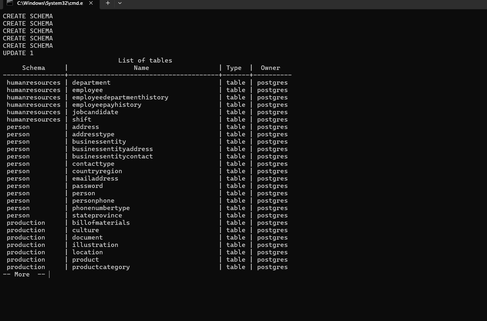
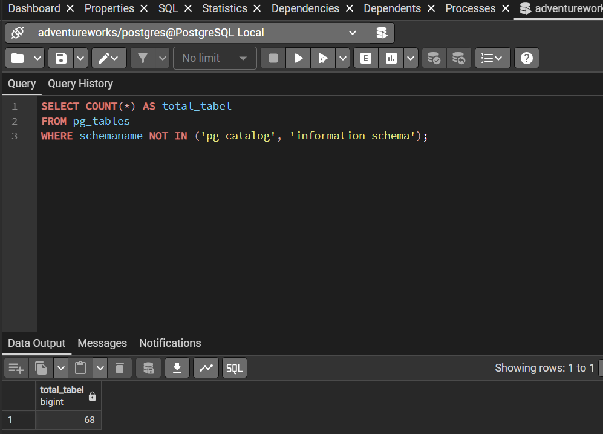
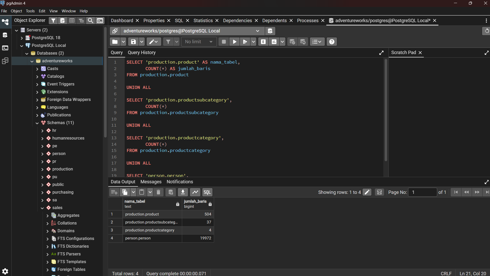
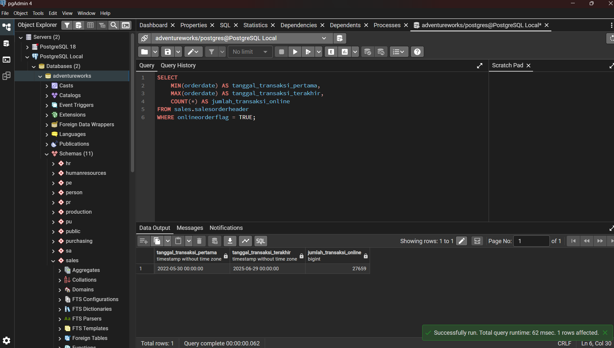
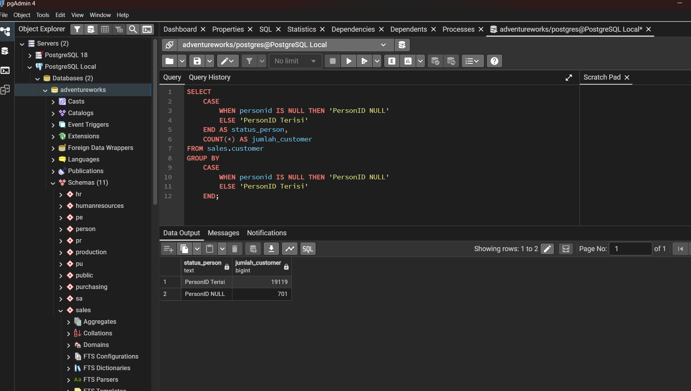

# Evidence — Data Source Profiling

Tangkapan layar berikut merupakan bukti visual pengerjaan Vernanda pada tahap persiapan database dan profiling sumber.

## Proses restore / instalasi database AdventureWorks.

## Validasi total 68 tabel.

## Hasil penghitungan jumlah record.

## Rentang tanggal transaksi online.

## Pemeriksaan lanjutan customer dengan PersonID NULL.

