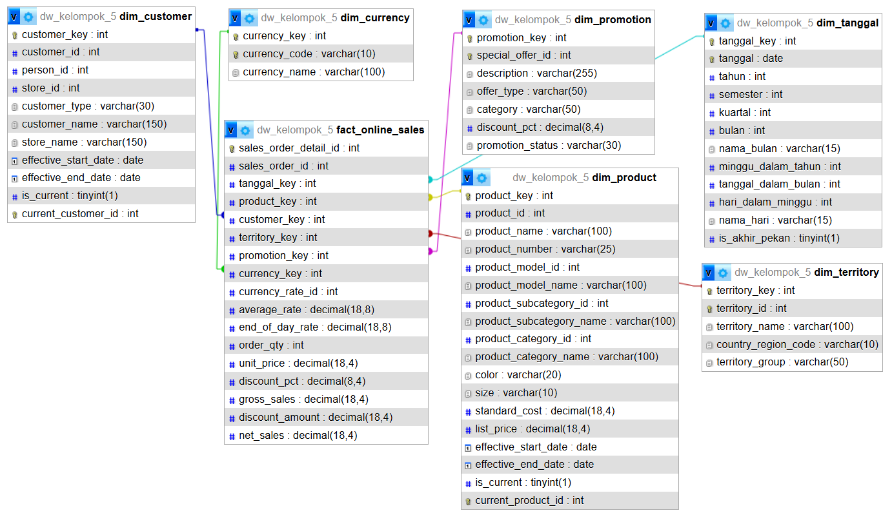
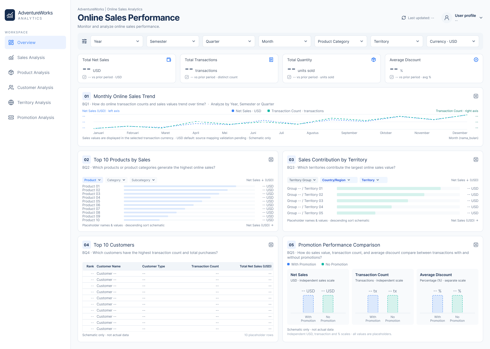
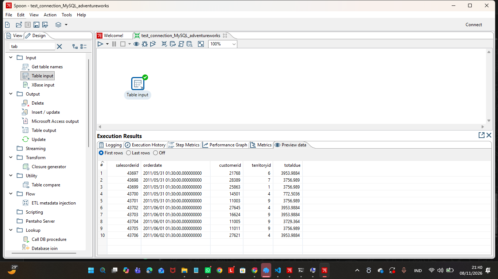

# Laporan Progres Pekan 10

**Kelompok:** Kelompok 5  
**Proses bisnis:** Online Sales  
**Database sumber:** MySQL `adventureworks`  
**Database Data Warehouse:** MariaDB `dw_kelompok_5`  
**Status:** Kuning

> Status kuning menunjukkan bahwa penyempurnaan Star Schema V2, Source-to-Target Mapping, desain OLAP Cube, wireframe dashboard, penyesuaian dimensi tanggal sesuai standar dosen, serta pengujian awal Pentaho telah dilakukan. Implementasi ETL penuh, pemuatan data dimension dan fact, konfigurasi Mondrian, dan integrasi dashboard dengan data aktual masih menjadi pekerjaan berikutnya.

---

## 1. Target dan Capaian

| Target Pekan Ini | Status | Bukti / Keterangan |
|---|---|---|
| Merevisi Star Schema versi 1 menjadi versi 2 berdasarkan masukan Steering Review. | Selesai pada tahap desain | [Star Schema V2](../03-data-model/star-schema-v2.png) |
| Menambahkan atribut Product Model pada `dim_product`. | Selesai pada tahap desain | `dim_product` mencakup Product Model, Subcategory, dan Category. |
| Meninjau kembali `dim_territory` dan keterkaitan salesperson. | Selesai pada tahap analisis dan desain | `dim_territory` menyimpan identitas wilayah. Salesperson tidak dimodelkan sebagai pemilik tunggal territory karena satu territory dapat memiliki beberapa salesperson. Ketersediaan `salespersonid` pada data MySQL perlu divalidasi. |
| Menambahkan dimensi mata uang untuk mendukung analisis currency. | Selesai pada tahap desain | `dim_currency` ditambahkan ke Star Schema V2. Asumsi USD untuk transaksi dengan `currencyrateid` NULL masih perlu divalidasi. |
| Menyusun Source-to-Target Mapping untuk seluruh tabel target. | Selesai pada tahap dokumentasi | [Source-to-Target Mapping](../03-data-model/source-to-target-mapping.md) |
| Menentukan strategi SCD untuk setiap dimension. | Selesai pada tahap desain | `dim_tanggal` Type 0, `dim_product` Type 2, `dim_customer` Type 2, `dim_territory` Type 1, `dim_promotion` Type 1, dan `dim_currency` Type 0. |
| Menentukan urutan load dari staging hingga fact table. | Selesai pada tahap desain | Urutan load staging, dimension, dan fact didokumentasikan pada Source-to-Target Mapping. |
| Merancang OLAP Cube beserta dimension, hierarki, measures, dan calculated member. | Selesai pada tahap desain | [Desain OLAP Cube](../04-OLAP/cube-design.md) |
| Membuat wireframe dashboard untuk menjawab lima Business Questions. | Selesai pada tahap wireframe | [Dokumentasi Wireframe Dashboard](../05-dashboard/dashboard-wireframe.md) dan [Wireframe Dashboard PNG](../05-dashboard/dashboard-wireframe.png) |
| Menyesuaikan dimensi tanggal dengan standar dosen. | Selesai pada struktur database dan dokumentasi | Tabel `dim_date` diganti menjadi `dim_tanggal`; kolom `fact_online_sales.date_key` diganti menjadi `tanggal_key`; relasi foreign key telah diperiksa. |
| Menjalankan query sederhana menggunakan Table Input pada Pentaho. | Selesai | Query transaksi online berhasil dijalankan dan Preview Data menampilkan data. [Bukti Table Input dan hasil query](../04-olap/pentaho/table_input_query_result.png) |
| Mengimplementasikan seluruh proses ETL untuk dimension dan fact. | Belum dilakukan | Menjadi pekerjaan lanjutan setelah koneksi sumber dan target siap digunakan untuk workflow ETL. |
| Mengonfigurasi OLAP Cube pada Mondrian dan menguji query MDX. | Belum dilakukan | Desain cube telah tersedia; konfigurasi dan pengujian implementasi belum dilakukan. |
| Mengintegrasikan dashboard dengan data aktual dari OLAP Cube. | Belum dilakukan | Wireframe telah tersedia; integrasi data dan implementasi dashboard menjadi pekerjaan berikutnya. |

### 1.1 Pernyataan Grain

Satu baris pada `fact_online_sales` merepresentasikan satu baris detail produk dalam satu transaksi penjualan online (*one row per sales order detail line*), dengan transaksi dibatasi pada `onlineorderflag = 1`.

### 1.2 Ringkasan Star Schema V2

Star Schema V2 terdiri dari satu fact table dan enam dimension.

| Komponen | Nama Tabel | Keterangan |
|---|---|---|
| Fact table | `fact_online_sales` | Satu baris per detail produk dalam transaksi online |
| Dimension 1 | `dim_tanggal` | Analisis berdasarkan tanggal, tahun, semester, kuartal, bulan, dan hari |
| Dimension 2 | `dim_product` | Memuat produk, model, subkategori, dan kategori |
| Dimension 3 | `dim_customer` | Memuat informasi pelanggan, person, dan store |
| Dimension 4 | `dim_territory` | Memuat identitas dan kelompok wilayah |
| Dimension 5 | `dim_promotion` | Memuat informasi promosi |
| Dimension 6 | `dim_currency` | Memuat kode dan nama mata uang |

**Perubahan dimensi waktu:** nama tabel standar dosen adalah `dim_tanggal`, dengan primary key `tanggal_key`. Kolom foreign key pada fact table adalah `fact_online_sales.tanggal_key`.

### 1.3 Ringkasan Struktur `dim_tanggal`

Tabel `dim_tanggal` mengikuti struktur standar yang diberikan dosen dan telah diterapkan pada database `dw_kelompok_5`.

| Atribut | Keterangan |
|---|---|
| `tanggal_key` | Primary key tanggal dengan format `YYYYMMDD`; `-1` untuk tanggal tidak diketahui |
| `tanggal` | Tanggal lengkap |
| `tahun` | Tahun kalender |
| `semester` | Semester 1 (Januari–Juni) atau 2 (Juli–Desember) |
| `kuartal` | Kuartal 1–4 |
| `bulan` | Nomor bulan 1–12 |
| `nama_bulan` | Nama bulan |
| `minggu_dalam_tahun` | Nomor minggu dalam tahun |
| `tanggal_dalam_bulan` | Hari ke-1 sampai 31 |
| `hari_dalam_minggu` | Nomor hari, Senin = 1 sampai Minggu = 7 |
| `nama_hari` | Nama hari |
| `is_akhir_pekan` | Penanda akhir pekan |

**Hierarki waktu OLAP:** Year → Semester → Quarter → Month → Date.

### 1.4 Ringkasan Strategi SCD

| Dimension | Strategi SCD |
|---|---|
| `dim_tanggal` | Type 0 |
| `dim_product` | Type 2 |
| `dim_customer` | Type 2 |
| `dim_territory` | Type 1 |
| `dim_promotion` | Type 1 |
| `dim_currency` | Type 0 |

### 1.5 Ringkasan Desain OLAP Cube

| Komponen | Rancangan |
|---|---|
| Nama cube | Online Sales Cube |
| Fact table | `fact_online_sales` |
| Dimension | Tanggal, Product, Customer, Territory, Promotion, Currency |
| Hierarki tanggal | Year → Semester → Quarter → Month → Date |
| Measures | Gross Sales, Discount Amount, Net Sales, Total Quantity, Transaction Count |
| Calculated member | Average Discount (%) dan Average Selling Price |
| OLAP engine | Mondrian |

### 1.6 Ringkasan Wireframe Dashboard

Dashboard dirancang untuk menjawab lima Business Questions. Filter waktu diperbarui dengan menambahkan Semester dan menggunakan atribut dari `dim_tanggal`.

| ID | Business Question | Visualisasi |
|---|---|---|
| BQ1 | Bagaimana tren jumlah transaksi dan nilai penjualan online per bulan/tahun? | Monthly Online Sales Trend — Line Chart dengan dual Y-axis |
| BQ2 | Produk atau kategori apa yang memiliki nilai penjualan online tertinggi? | Top 10 Products by Sales — Horizontal Bar Chart |
| BQ3 | Wilayah mana yang memberikan kontribusi nilai penjualan online terbesar? | Sales Contribution by Territory — Horizontal Bar Chart |
| BQ4 | Pelanggan mana yang memiliki jumlah transaksi dan total pembelian tertinggi? | Top 10 Customers — Data Table |
| BQ5 | Bagaimana perbandingan penjualan, transaksi, dan rata-rata diskon antara transaksi dengan dan tanpa promosi? | Promotion Performance Comparison — tiga panel perbandingan |

Filter waktu pada wireframe: **Year → Semester → Quarter → Month**. Pada tren bulanan, `nama_bulan` digunakan sebagai label dan `bulan` sebagai dasar pengurutan.

### 1.7 Ringkasan Pengujian Pentaho

| Komponen | Hasil |
|---|---|
| Pentaho Data Integration | Community Edition 9.4.0.0-343 |
| Antarmuka | Spoon berhasil dibuka |
| Database sumber | MySQL `adventureworks` |
| Step yang diuji | Table Input |
| Query | Mengambil data transaksi dengan `onlineorderflag = 1` |
| Hasil | Query berhasil dijalankan dan Preview Data menampilkan data transaksi |

**Catatan:** Pengujian ini membuktikan koneksi dasar Pentaho ke database sumber MySQL dan eksekusi query sederhana. Pengujian belum mencakup workflow ETL penuh, load dimension, load fact, maupun penanganan SCD.

### 1.8 Kondisi Database Data Warehouse

Database target yang digunakan adalah `dw_kelompok_5`. Struktur tujuh tabel telah dibuat. Seluruh tabel diperiksa dan masih kosong pada saat pemeriksaan, sehingga penyesuaian struktur dimensi tanggal dapat dilakukan sebelum proses load data.

| Pemeriksaan | Hasil |
|---|---|
| Database target | `dw_kelompok_5` |
| Jumlah tabel Star Schema | 7 tabel |
| Tabel tanggal lama | `dim_date` telah diganti |
| Tabel tanggal terbaru | `dim_tanggal` |
| Foreign key tanggal | `fact_online_sales.tanggal_key` mengacu ke `dim_tanggal.tanggal_key` |
| Data dimension dan fact | Belum dimuat |

---

## 2. Kendala Pengerjaan

1. **Penentuan mata uang untuk transaksi tanpa `currencyrateid`.** Sebagian transaksi online memiliki `currencyrateid` NULL. USD sementara digunakan sebagai asumsi mata uang dasar, tetapi perlu dikonfirmasi melalui aturan bisnis atau metadata sumber sebelum proses ETL final.
2. **Riwayat perubahan untuk penerapan SCD Type 2.** Sumber data saat ini belum tentu menyediakan riwayat perubahan atribut produk dan pelanggan. Riwayat sebelum ETL mulai berjalan tidak dapat direkonstruksi jika tidak tersedia pada sumber. Mekanisme historisasi perlu diterapkan sejak proses ETL berjalan.
3. **Relasi salesperson dan territory.** Satu territory dapat memiliki beberapa salesperson. Ketersediaan `salespersonid` pada transaksi online MySQL perlu divalidasi sebelum menetapkan kesimpulan berdasarkan dataset yang digunakan.
4. **Perbedaan satuan mata uang.** Data penjualan menggunakan beberapa mata uang. Agregasi lintas mata uang tidak boleh dilakukan secara langsung tanpa konversi ke mata uang dasar yang disepakati.
5. **Implementasi ETL belum dilakukan secara penuh.** Pengujian Pentaho baru membuktikan koneksi dan pembacaan data melalui Table Input. Proses staging, transformasi dimension, lookup surrogate key, dan load fact masih perlu dibangun.
6. **Konfigurasi OLAP dan dashboard masih dalam tahap rancangan.** Desain cube dan wireframe telah disusun, tetapi Mondrian dan dashboard belum dihubungkan dengan data aktual.
7. **Penyesuaian struktur tanggal.** Struktur awal `dim_date` perlu diselaraskan dengan tabel standar dosen `dim_tanggal`. Penyesuaian nama tabel, primary key, foreign key, mapping, hierarki cube, dan filter dashboard telah dilakukan pada rancangan dan struktur database. Penyesuaian lanjutan tetap diperlukan pada workflow ETL dan schema Mondrian.

---

## 3. Kendala Tim

Belum ada informasi terverifikasi mengenai kendala komunikasi, anggota yang sulit dihubungi, atau keterlambatan pembagian tugas pada Pekan 10. Bagian ini perlu diperbarui berdasarkan kondisi aktual tim.

---

## 4. Keputusan yang Membutuhkan Persetujuan Sponsor

1. Menyetujui Star Schema V2 yang terdiri dari `fact_online_sales` dan enam dimension: `dim_tanggal`, `dim_product`, `dim_customer`, `dim_territory`, `dim_promotion`, dan `dim_currency`.
2. Menyetujui atribut tambahan Product Model, Subcategory, dan Category pada `dim_product`.
3. Menyetujui penggunaan struktur `dim_tanggal` standar dosen, termasuk hierarki Year → Semester → Quarter → Month → Date.
4. Menyetujui rancangan `dim_currency` dan aturan penentuan mata uang transaksi ketika `currencyrateid` bernilai NULL, termasuk validasi asumsi USD.
5. Menyetujui strategi SCD yang diusulkan: `dim_tanggal` Type 0, `dim_product` Type 2, `dim_customer` Type 2, `dim_territory` Type 1, `dim_promotion` Type 1, dan `dim_currency` Type 0.
6. Menyetujui penanganan transaksi tanpa promosi melalui anggota khusus `No Promotion` pada `dim_promotion` dan anggota `Unknown` pada dimension yang diperlukan.
7. Menyetujui rancangan hierarki, measures, dan calculated member pada Online Sales Cube.
8. Mengonfirmasi kebijakan analisis nilai penjualan multi-currency: menggunakan filter mata uang transaksi atau mengonversi nilai ke mata uang dasar yang ditetapkan.

---

## 5. Rencana Pekan Depan

| Target | Penanggung Jawab |
|---|---|
| Memfinalisasi Star Schema V2 dan menindaklanjuti persetujuan sponsor. | Zyndi Auralia Wibowo — Data Modeler |
| Memvalidasi aturan currency dan NULL; menyiapkan staging serta ETL dimension dan fact di Pentaho. | Vernanda Pramudya Sejati — ETL Developer |
| Menyiapkan konfigurasi schema Mondrian berdasarkan desain cube dan mulai menguji hierarki serta measures. | Reva Luvika Apriliani — OLAP Developer |
| Menyempurnakan wireframe dan menyiapkan rancangan implementasi dashboard berdasarkan lima Business Questions. | Caroline Febryanty — Dashboard Developer |
| Mengkoordinasikan progres, pembagian tugas, dokumentasi, dan persetujuan sponsor. | Afiana Nurani — Project Manager |

---

## 6. Kontribusi Anggota

| Nama | Peran | Pekerjaan Pekan Ini | Bukti Commit |
|---|---|---|---|
| Afiana Nurani | Project Manager | Koordinasi dan pemantauan progres proyek serta dokumentasi laporan Pekan 10. Rincian aktivitas aktual perlu dikonfirmasi. | Belum dicantumkan |
| Caroline Febryanty | Dashboard Developer | Menyusun dan menyesuaikan wireframe Online Sales Performance Dashboard menggunakan Figma AI, mencakup KPI, lima visualisasi BQ1–BQ5, serta filter waktu Semester. | [Bukti commit wireframe dashboard](Laporan_pekan10_assets/bukti_commit_caroline.png) |
| Reva Luvika Apriliani | OLAP Developer | Menyusun dan memperbarui desain Online Sales Cube, hierarki dimension, measures, calculated member, serta hierarki waktu berdasarkan `dim_tanggal`. | [Bukti commit cube design](Laporan_pekan10_assets/bukti_commit_reva.png) |
| Zyndi Auralia Wibowo | Data Modeler | Menyempurnakan Star Schema V2 dan Source-to-Target Mapping, termasuk penyesuaian `dim_tanggal` sesuai standar dosen. | [Bukti commit Star Schema V2 dan Source-to-Target Mapping](Laporan_pekan10_assets/bukti_commit_zyndi.png) |
| Vernanda Pramudya Sejati | ETL Developer | Menyiapkan PDI CE 9.4, menjalankan Spoon, menghubungkan MySQL `adventureworks`, dan menguji query menggunakan Table Input. | [Bukti commit pengujian koneksi Pentaho](Laporan_pekan10_assets/bukti_commit_vernanda.png) |

> **Catatan:** Tautan bukti commit di atas merupakan placeholder berdasarkan struktur laporan sebelumnya. Pastikan setiap file bukti benar-benar tersedia di repository dan ganti tautan jika nama atau lokasinya berbeda. Rincian kontribusi anggota perlu dikonfirmasi oleh masing-masing anggota sebelum laporan diserahkan.

---

## 7. Lampiran Bukti Tangkapan Layar

Simpan bukti tangkapan layar pada folder `Laporan_pekan10_assets/`, kemudian sesuaikan nama file dan tautan relatif di bawah dengan file yang benar-benar tersedia di repository.

### A. Star Schema V2

### B. Source-to-Target Mapping

[ Buka dokumen Source-to-Target Mapping ](../03-data-model/source-to-target-mapping.md)

### C. Desain OLAP Cube

[ Buka dokumen Desain OLAP Cube ](../04-OLAP/cube-design.md)

### D. Wireframe Online Sales Performance Dashboard

### E. Table Input dan Hasil Query Transaksi Online

### F. Struktur `dim_tanggal` dan Relasi Fact

Tambahkan tangkapan layar phpMyAdmin yang memperlihatkan:
- Struktur kolom `dim_tanggal`.
- Kolom `tanggal_key` pada `fact_online_sales`.
- Foreign key `fk_fact_tanggal` yang mengarah ke `dim_tanggal.tanggal_key`.

---

## Kesimpulan

Pada Pekan 10, Kelompok 5 telah melanjutkan pekerjaan Data Warehouse Online Sales dari tahap persiapan sumber data dan rancangan awal menuju penyempurnaan model dimensional, desain OLAP, wireframe dashboard, serta pengujian awal perangkat ETL. Star Schema V2 telah dirancang dengan satu fact table dan enam dimension. Source-to-Target Mapping, strategi SCD, urutan load, desain Online Sales Cube, dan wireframe dashboard untuk lima Business Questions juga telah disusun.

Penyesuaian terhadap standar dimensi tanggal dari dosen telah dilakukan. Tabel `dim_date` diganti menjadi `dim_tanggal`, primary key menggunakan `tanggal_key`, dan foreign key pada `fact_online_sales` telah disesuaikan. Dokumentasi Source-to-Target Mapping, desain OLAP Cube, dan wireframe dashboard juga diperbarui agar menggunakan struktur tanggal terbaru. Struktur database target telah diperiksa, sedangkan proses pemuatan data belum dilakukan.

Pengujian awal Pentaho Data Integration Community Edition 9.4 berhasil dilakukan. Spoon dapat dibuka, koneksi ke MySQL `adventureworks` berhasil digunakan, dan query sederhana melalui Table Input berhasil menampilkan data transaksi online.

Tahap berikutnya adalah membangun proses ETL secara bertahap, memuat tabel dimension dan fact ke database Data Warehouse, mengonfigurasi Mondrian, menguji query MDX, serta mengintegrasikan dashboard dengan data aktual.
